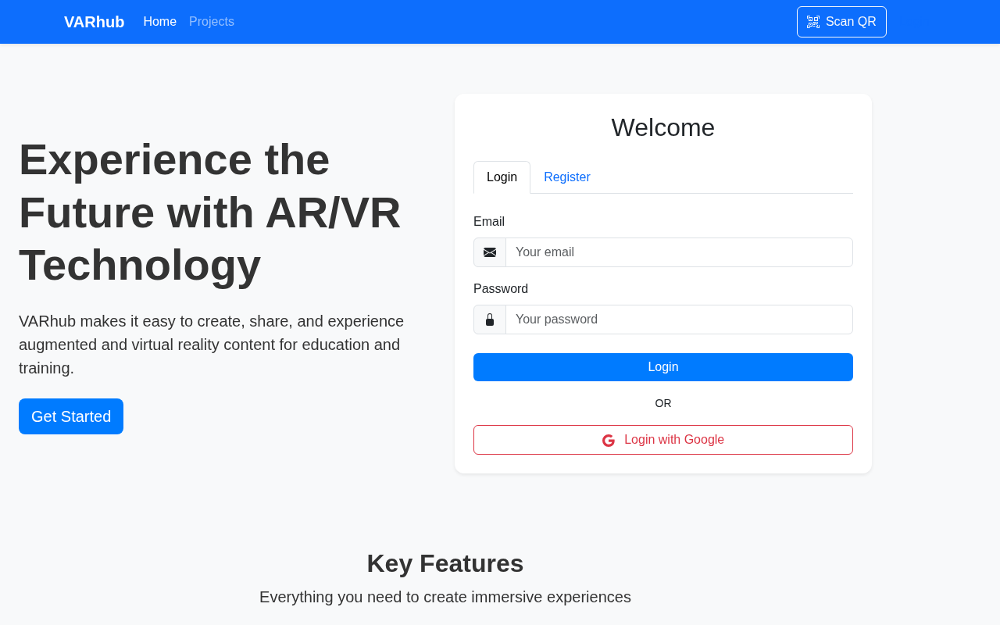

# VARHub (client)

**English** · [Português](README.md)

**VARLab**'s web marketing platform: project gallery, AR via QR code (WebXR, Three.js, A-Frame), feedback, PWA and push notifications. It was my **capstone project at Conestoga College**.

📖 Documentation: https://ettorecsenatore.github.io/varhub-client/ (Portuguese and English)

This repository is the **client** (React 19 + Vite). The API lives in [varhub-server](https://github.com/EttoreCSenatore/varhub-server).



## Running locally

```bash
npm ci --allow-git=all   # A-Frame brings a dependency fetched from GitHub
cp .env.example .env     # VITE_API_URL=http://localhost:5000
npm run dev
```

See [Development](https://ettorecsenatore.github.io/varhub-client/en/docs/tecnico/desenvolvimento) to start the server and database. Vulnerabilities: [SECURITY.md](SECURITY.md).

## License

[MIT](LICENSE.txt). The samples in `public/webxr-samples-main` are MIT, © The Immersive Web Community Group.
