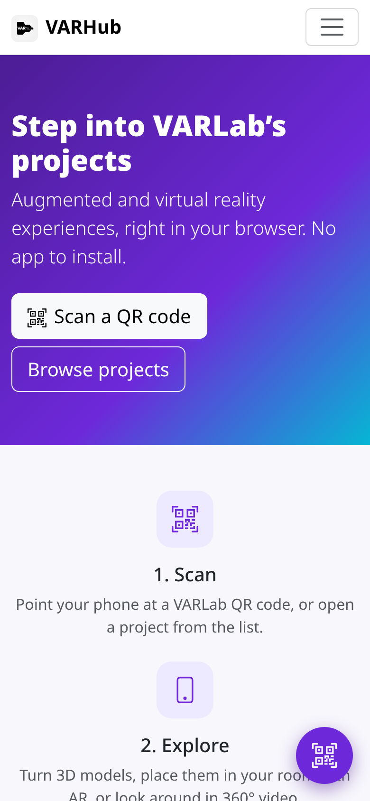

# VARHub (cliente)

[English](README.en.md) · **Português**

**Conceito livre para publicar projetos de VR e AR para empresas e escolas.** O público escaneia um QR Code e explora **modelos 3D com AR** e **vídeo 360°** no celular, e deixa feedback sem conta. A equipe tem um painel com métricas e QR Codes para imprimir. Pode ser **adaptado por qualquer negócio ou instituição** (nome, logotipo, cores e conteúdo são configuráveis). Nasceu como o meu **projeto final no Conestoga College**, com o VARLab como caso de uso original.

📖 Documentação: https://ettorecsenatore.github.io/varhub-client/ (português e inglês)

Este repositório é o **cliente** (React 19 + Vite). A API está em [varhub-server](https://github.com/EttoreCSenatore/varhub-server).



## Rodando localmente

```bash
npm ci
npm run dev              # o Vite repassa /api para http://localhost:5000
npm run dev:phone        # HTTPS na rede local, para testar câmera e AR no celular
```

Veja [Desenvolvimento](https://ettorecsenatore.github.io/varhub-client/docs/tecnico/desenvolvimento) para subir o servidor e o banco. Vulnerabilidades: [SECURITY.md](SECURITY.md).

## Licença

[MIT](LICENSE.txt): software livre, você pode usar, modificar e distribuir, inclusive comercialmente. Nomes e logotipos do VARLab e do Conestoga College não são licenciados. Veja [Adaptar ao seu negócio](https://ettorecsenatore.github.io/varhub-client/docs/adaptar).
