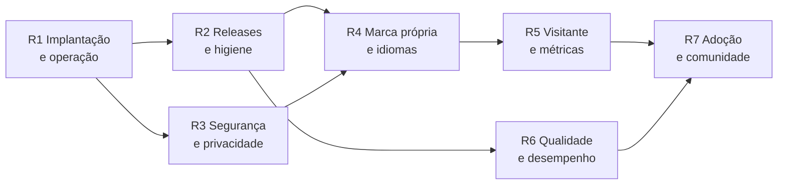

# Roadmap

Este roadmap parte de uma comparação com o [Kaladrius](https://github.com/facchini-miguel/kaladrius), um sistema livre e auto-hospedado para clínicas, bem mais maduro em operação, segurança e engenharia de releases. O domínio é outro (dados de saúde, muito mais sensíveis que um mostruário de AR), então copiamos o que serve ao VARHub e deixamos o resto.

## Onde estamos (v2.0)

- Galeria pública, página de projeto com 3D e AR (`<model-viewer>`), vídeo 360°, demos WebXR e leitor de QR Code.
- Feedback anônimo, eventos de uso, painel com métricas, gestão de projetos e QR Codes para imprimir.
- Contas com JWT e papéis (visitante e administrador), PWA com cache offline.
- API com migrações e testes de integração; CI nos dois repositórios; documentação em dois idiomas; licença AGPL-3.0.
- **Falta o principal:** não existe uma instalação no ar. O backend original na Railway foi removido, então nenhum visitante consegue usar o app hoje.

## O que aprendemos com o Kaladrius

| Prática | No Kaladrius | No VARHub hoje | Decisão |
|---|---|---|---|
| Instalação em um comando | Docker Compose de produção com Caddy (HTTPS automático), imagem no GHCR, pacotes `.deb` e `.rpm` | Só desenvolvimento local | **Adotar** Compose e imagens (R1); pacotes de Linux não |
| Demo pública com reset noturno | Servidor de referência e contas de demonstração | Nenhuma demo | **Adotar** (R1) |
| Backup e restauração testados | Backup diário, restauração testada em PostgreSQL descartável | Nenhum | **Adotar** (R1) |
| Saúde e monitoramento | `/api/v1/version`, verificações de saúde, alertas por Healthchecks.io | `/health` simples | **Adaptar** (R1) |
| Releases | `releases.yaml` como fonte única, SemVer, GitHub Release criado pelo CI, "O que há de novo" no app | Versão fixa, sem releases | **Adotar** (R2) |
| Registro de decisões | mais de 200 decisões numeradas, com motivo e status | Decisões só nos PRs e na memória | **Adotar** (R2) |
| Higiene do repositório | CONTRIBUTING, CODE_OF_CONDUCT, NOTICE (marca), CODEOWNERS, Dependabot, Actions fixadas por commit | LICENSE, SECURITY e README | **Adotar** (R2) |
| Segurança | Argon2, bloqueio por tentativas, 2FA opcional, CSP sem CDN, log de auditoria imutável, retenção | bcrypt, limite por IP, sem CSP, sem auditoria | **Adaptar** na medida do risco (R3) |
| Privacidade (LGPD) | Política de privacidade no sistema, exclusão de dados, retenção | Nenhuma página de privacidade | **Adotar** (R3) |
| Vários idiomas | Interface e documentação em inglês, português e espanhol, com verificação no CI | Interface só em inglês | **Adotar** (R4) |
| Configuração pela interface | Ajustes da clínica dentro do sistema | Marca por variáveis de ambiente no build | **Adotar** (R4) |
| Dados de demonstração | Clínica fictícia, 600 pacientes, semanas de atividade simulada | 4 projetos de exemplo | **Adotar** (R5) |
| Rigor no CI | Cobertura mínima, formatação, relatório de migrações, build da documentação | Testes sem limite de cobertura, sem relatório de migrações | **Adotar** (R6) |
| Documentação completa | Início rápido, manual por perfil, operação, modelo de dados, FAQ, glossário | 9 páginas | **Adotar** (R7) |
| API documentada | OpenAPI automático | Tabela manual | **Adaptar** (R6) |

### O que não vamos copiar

- **Pacotes `.deb`/`.rpm`, repositório apt e autoatualização com rollback:** pesados demais para um mostruário; Docker Compose basta.
- **App nativo (React Native):** o VARHub é um PWA de propósito, para abrir direto pelo QR Code sem instalar nada.
- **2FA obrigatório e sessão de 30 minutos:** adequados a prontuários, excessivos aqui. O 2FA fica opcional para administradores.
- **Módulos de clínica** (finanças, OFX, planos de saúde) e **guias de Google Cloud.**

## Ordem de execução

Tamanhos: **P** (até meio dia), **M** (1 a 2 dias), **G** (mais de 2 dias). Cada item vira um PR revisado e mesclado com o CI verde.

## R1. Funcionar de verdade: implantação e operação

Objetivo: uma instalação pública, com demo, que sobrevive a falhas. É o marco mais importante.

- [x] Dockerfile do servidor e do cliente (arquivos estáticos servidos pelo Caddy). (M)
- [x] `docker-compose.prod.yml` com PostgreSQL, API e Caddy com HTTPS automático, e `.env.example` de produção. (M)
- [x] Publicar as imagens no GHCR pelo CI. (P)
- [ ] Instalação de referência na VPS própria, com domínio próprio. (G)
- [ ] Demo pública: o reset noturno e a conta de demonstração já existem (`demo:reset`, timer do systemd); falta instalar no servidor. (M)
- [x] Backup diário com `pg_dump`, retenção de 30 dias e **teste de restauração** no CI. (M)
- [x] `/api/version` e versão no rodapé; alertas de disponibilidade e de backup (Healthchecks.io ou Uptime Kuma). (P)
- [x] Páginas de operação na documentação: instalação, backup e restauração, atualização, monitoramento. (M)
- [ ] Decidir o destino do deploy da Vercel: apontar `VITE_API_URL` para a instalação nova ou aposentá-lo. (P)

Pronto quando: a URL pública funciona em um celular, o painel mostra dados, e um backup foi restaurado com sucesso em um teste automático.

## R2. Releases e higiene do projeto

Objetivo: histórico claro e um repositório fácil de contribuir.

- [x] SemVer e um `releases.yaml` como fonte única do histórico, com tipos `new`, `improvement`, `fix` e `security`. (M)
- [x] O CI cria a tag e o GitHub Release quando a versão sobe; página "O que há de novo" no app. (M)
- [x] Registro de decisões na documentação, com as decisões já tomadas (dois repositórios, AGPL, `jose`, `<model-viewer>`, feedback anônimo, PWA em vez de app nativo). (M)
- [x] CONTRIBUTING, CODE_OF_CONDUCT, NOTICE (marcas), CODEOWNERS e modelos de issue e PR. (P)
- [x] Dependabot (semanal para bibliotecas, mensal para Actions) e Actions fixadas por commit. (P)
- [x] Regra de proteção do `main` (sem force-push, PR obrigatório, CI verde). (P)

Pronto quando: subir a versão e mesclar publica um release sozinho.

## R3. Segurança e privacidade

Objetivo: fechar a lista "o que ainda falta" da página de segurança.

- [ ] Content Security Policy sem inline e sem CDN (ajustando `<model-viewer>`) e HSTS no Caddy. (M)
- [ ] Bloqueio por conta e IP (5 erros por hora), além do limite global. (P)
- [ ] Log de auditoria append-only das ações de administrador (criar e editar projeto, mudar papel, falhas de login) e tela de consulta. (M)
- [ ] Política de privacidade em `/privacy` (LGPD, GDPR, PIPEDA) e exclusão da própria conta; retenção automática de eventos e tentativas de login. (M)
- [ ] Moderação de comentários (ocultar e denunciar) e limites contra abuso. (M)
- [ ] Verificação de e-mail e recuperação de senha, quando houver SMTP configurado. (M)
- [ ] Sessão em cookie `HttpOnly` no lugar do token no `localStorage`, com proteção CSRF. (G)
- [ ] 2FA opcional (TOTP) para administradores, com códigos de recuperação. (G)
- [ ] Varredura OWASP ZAP baseline no CI. (P)

Pronto quando: a seção "O que ainda falta" da página de segurança estiver vazia ou justificada.

## R4. Marca própria e vários idiomas

Objetivo: uma organização nova se adapta sem mexer no código nem recompilar.

- [ ] Ajustes da organização no banco e uma tela no painel: nome, tagline, cores, logotipo, link de código-fonte e contato, servidos por `/api/settings`. (G)
- [ ] Interface em inglês, português e espanhol, com seletor de idioma e verificação de chaves ausentes no CI. (G)
- [ ] Título e descrição de projeto por idioma. (M)
- [ ] Papel de editor (gerencia conteúdo, sem acesso a papéis e auditoria). (M)
- [ ] Envio de modelos, vídeos e miniaturas pelo painel, com limite de tipo e tamanho e armazenamento local ou compatível com S3. (G)
- [ ] Categorias, destaque e ordem dos projetos. (M)

Pronto quando: uma escola nova troca nome, logotipo, cores e idioma só pelo painel.

## R5. Experiência do visitante e métricas

Objetivo: reforçar o fluxo que dá sentido ao produto: escanear, explorar, opinar.

- [ ] QR Codes por local (`?src=qr&loc=hall-a`) e métricas por ponto de colocação. (M)
- [ ] Kit de impressão: cartaz em PDF com logotipo, QR Code e link curto estável (`/p/abc`). (M)
- [ ] Painel com intervalo de datas, funil por projeto (escaneou, abriu, usou AR ou vídeo, avaliou) e exportação CSV. (M)
- [ ] Feedback estruturado (nota de recomendação) e e-mail opcional com consentimento. (M)
- [ ] Notificações push sem fornecedor (Web Push com VAPID): inscrição no cliente, token no servidor, envio pelo painel. (G)
- [ ] Modo offline por projeto ("baixar para ver sem internet"). (M)
- [ ] Dados de demonstração realistas: atividade simulada de semanas, um vídeo 360° de exemplo com CORS. (M)
- [ ] Revisão de acessibilidade (WCAG 2.2 AA): teclado, contraste, legendas no vídeo 360°, `axe` nos testes. (M)
- [ ] Roteiros e coleções de projetos (trilha de QR Codes); mapa 2D do campus com ARWay como prova de conceito. (G)

Pronto quando: a equipe imprime um cartaz, vê no painel de onde vêm os escaneamentos e recebe feedback estruturado.

## R6. Qualidade e desempenho

Objetivo: confiança para mudar sem quebrar.

- [ ] Cobertura mínima no CI (servidor 85%, cliente 70%), ESLint e Prettier no servidor. (M)
- [ ] Testes de ponta a ponta com Playwright em viewport de celular: leitor, projeto, feedback, painel. (G)
- [ ] Lighthouse CI com orçamento: PWA acima de 90 e JavaScript inicial abaixo de 350 KB. (M)
- [ ] Especificação OpenAPI da API `/api/v1`, publicada para administradores, e testes de contrato. (M)
- [ ] Relatório de migrações em PRs que as alteram: SQL gerado, operações destrutivas e teste de ida e volta no PostgreSQL de produção. (M)
- [ ] Revisão de índices e paginação em projetos e eventos; teste de carga básico com k6. (M)

Pronto quando: um PR que quebra o fluxo principal ou estoura o orçamento de tamanho não passa no CI.

## R7. Adoção e comunidade

Objetivo: outras organizações conseguirem instalar e usar sem ajuda.

- [ ] Início rápido de 5 minutos, referência de configuração, FAQ e glossário. (M)
- [ ] Manual do administrador (cadastrar projeto, gerar QR Code, ler as métricas) e manual do visitante. (M)
- [ ] Página do modelo de dados e guias de instalação (Docker Compose e VPS). (M)
- [ ] Pacotes de exemplo por segmento (escola, empresa, museu) como dados iniciais. (M)
- [ ] Botões de implantação em um clique (Railway ou Render) onde fizer sentido. (P)
- [ ] Estudo de caso e atualização do portfólio com a demo no ar. (P)

Pronto quando: alguém de fora instala, troca a marca e publica um projeto só com a documentação.

## Próximos passos imediatos

1. **R1:** Dockerfiles, Compose de produção e imagens no GHCR.
2. **R2 em paralelo:** registro de decisões e arquivos de comunidade, que não dependem de infraestrutura.
3. **R1:** subir a instalação de referência com a demo e o backup testado.
4. **R2:** `releases.yaml` e release automático, e então a versão 2.1.

## Pontos de atenção

- Vídeos 360° precisam de hospedagem com cabeçalhos CORS; sem isso o navegador bloqueia a textura.
- A câmera e o WebXR exigem **HTTPS**. Em desenvolvimento use `npm run dev:phone`.
- Decisão de produto em aberto: manter **uma instalação por organização** (mais simples, é o que o Kaladrius faz) ou evoluir para várias organizações em uma instalação. O roadmap assume a primeira.
