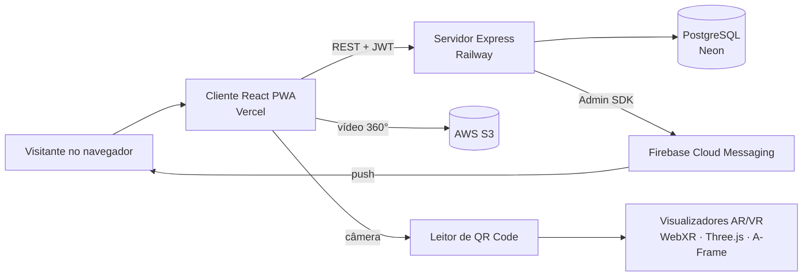
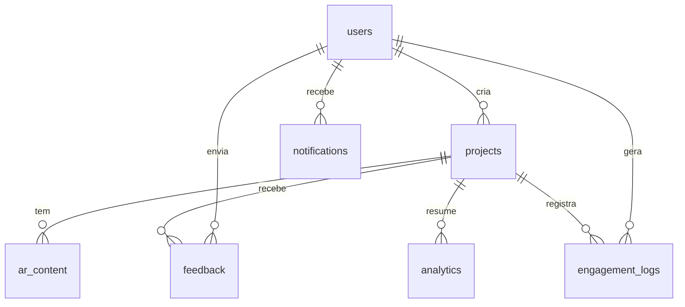

# Arquitetura

O VARHub é uma aplicação de página única (SPA/PWA) que conversa com uma API REST. Dois serviços externos completam o desenho: o **Neon** (PostgreSQL) e o **Firebase** (push).



## Cliente (`varhub-client`)

```text
src/
  App.jsx                 rotas: /, /login, /projects (privada), /scan
  context/AuthContext.jsx login, cadastro e sessão (token no localStorage)
  utils/api.js            Axios com o token JWT em cada requisição
  pages/                  Home, Login, Projects, QRScanner
  components/             NavBar, Footer, PrivateRoute, QRScanner, ARViewer, FeedbackForm
  firebase.js             configuração do Firebase e permissão de notificações
public/
  firebase-messaging-sw.js  service worker das notificações em segundo plano
  webxr-samples-main/       exemplos WebXR locais (MIT)
website/                  este site de documentação (Docusaurus)
```

A rota `/projects` usa `PrivateRoute`: sem token, o visitante vai para o login. O PWA é gerado por `vite-plugin-pwa` (Workbox), com cache-first para imagens e modelos `.glb` e network-first para PDF e JSON.

## Servidor (`varhub-server`)

```text
server.js                 Express, CORS por lista, Helmet, rate limit, /health
db.js                     pool do PostgreSQL (SSL com verificação)
middleware/auth.js        requireAuth, optionalAuth e signToken (JWT HS256)
controllers/ + routes/    auth, projects, feedback, analytics, notifications
firebaseAdmin.js          Firebase Admin (variável de ambiente ou arquivo local)
db/schema.sql             esquema das tabelas
scripts/check-*.js        utilitários que conferem/criam tabelas
```

## Modelo de dados



Detalhes das colunas em `db/schema.sql`. A tabela `engagement_logs` aceita `user_id` nulo para visitantes anônimos.

## Implantação

O cliente é publicado na Vercel (variável `VITE_API_URL` aponta para o servidor) e o servidor na Railway, que fica atrás de proxy (`trust proxy` ligado). A origem do cliente precisa estar em `ALLOWED_ORIGINS` para o CORS.
