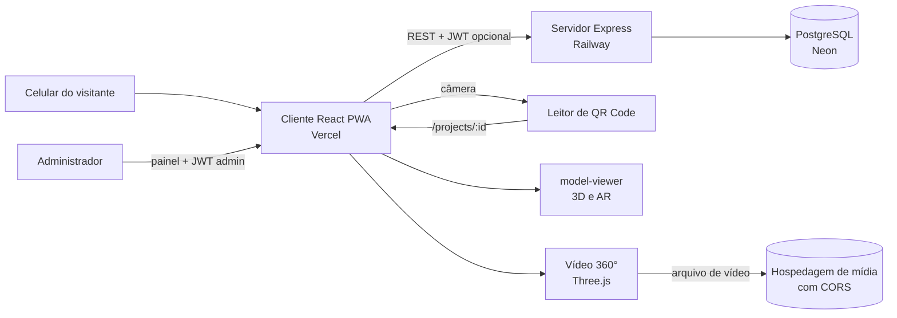
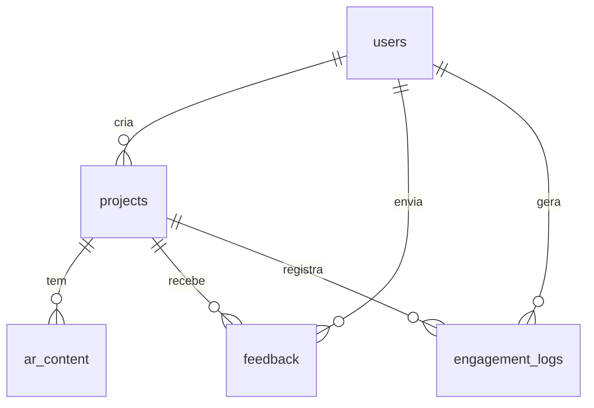

# Arquitetura

O VARHub é uma aplicação de página única (SPA/PWA) que conversa com uma API REST e com o PostgreSQL.



## Cliente (`varhub-client`)

```text
src/
  App.jsx                 rotas, com páginas carregadas sob demanda
  context/AuthContext.jsx sessão: token no localStorage, validado em /api/auth/me
  brand.js                nome, organização, tagline e link de código-fonte (via .env)
  utils/api.js            Axios, mensagens de erro e track() de eventos
  utils/qr.js             decide o que um QR Code significa (testado)
  pages/                  Home, Projects, Project, Scan, Login, Admin
  components/             NavBar, ModelViewer, Video360, QRScanner, FeedbackForm, ProjectCard...
vite.config.js            proxy /api, HTTPS opcional (dev:phone), PWA e cache
website/                  este site de documentação (Docusaurus)
```

Decisões que importam:

- **Primeira tela leve.** O JavaScript inicial tem cerca de 300 KB; o visualizador 3D, o vídeo 360° e o painel só carregam nas páginas que os usam.
- **Sem login para o visitante.** Galeria, projeto e feedback são públicos; conta é opcional.
- **Mesma origem em desenvolvimento.** O Vite repassa `/api` ao servidor, evitando CORS e conteúdo misto no celular.
- **Funciona offline.** A lista de projetos usa *stale-while-revalidate*; imagens e modelos usam cache primeiro.

## Servidor (`varhub-server`)

```text
app.js / server.js        Express (testável) e inicialização
db.js                     pool do PostgreSQL (TLS verificado fora do localhost)
middleware/auth.js        requireAuth, optionalAuth, requireAdmin, signToken (JWT HS256)
middleware/limits.js      limites de requisições
controllers/ + routes/    auth, projects, feedback, analytics, notifications
db/migrations/*.sql       esquema versionado; db/seed.sql com dados de demonstração
scripts/                  migrate.js e make-admin.js
test/api.test.js          testes de integração
```

## Modelo de dados



`users.role` é `visitor` ou `admin`. `projects.type` é `model`, `video360`, `webxr` ou `link`, e `projects.status` é `draft`, `published` ou `archived` (só os publicados aparecem ao público). `feedback.user_id` e `engagement_logs.user_id` são nulos para visitantes anônimos.

## Implantação

O cliente vai para a Vercel com `VITE_API_URL` apontando para o servidor; o servidor vai para um host Node com PostgreSQL (Railway e Neon no projeto original). A origem do cliente precisa estar em `ALLOWED_ORIGINS`.
