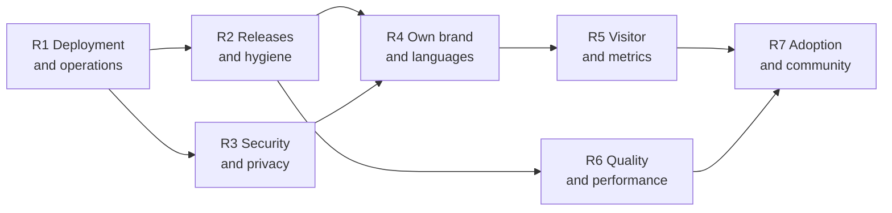

# Roadmap

This roadmap starts from a comparison with [Kaladrius](https://github.com/facchini-miguel/kaladrius), a free, self-hosted system for clinics that is much more mature in operations, security and release engineering. Its domain is different (health data, far more sensitive than an AR showcase), so we copy what fits VARHub and leave the rest.

## Where we are (v2.0)

- Public gallery, project page with 3D and AR (`<model-viewer>`), 360° video, WebXR demos and a QR scanner.
- Anonymous feedback, usage events, a dashboard with metrics, project management and printable QR codes.
- JWT accounts with roles (visitor and admin), PWA with offline cache.
- API with migrations and integration tests; CI on both repositories; documentation in two languages; AGPL-3.0 license.
- **The essential part is missing:** there is no live installation. The original backend on Railway was removed, so no visitor can use the app today.

## What we learned from Kaladrius

| Practice | In Kaladrius | In VARHub today | Decision |
|---|---|---|---|
| One-command install | Production Docker Compose with Caddy (automatic HTTPS), image on GHCR, `.deb` and `.rpm` packages | Local development only | **Adopt** Compose and images (R1); Linux packages no |
| Public demo with nightly reset | Reference server and demo accounts | No demo | **Adopt** (R1) |
| Tested backup and restore | Daily backup, restore tested into a throwaway PostgreSQL | None | **Adopt** (R1) |
| Health and monitoring | `/api/v1/version`, health checks, Healthchecks.io alerts | A simple `/health` | **Adapt** (R1) |
| Releases | `releases.yaml` as a single source, SemVer, GitHub Release created by CI, "What's new" in the app | Fixed version, no releases | **Adopt** (R2) |
| Decision log | More than 200 numbered decisions, with reason and status | Decisions only in PRs and notes | **Adopt** (R2) |
| Repository hygiene | CONTRIBUTING, CODE_OF_CONDUCT, NOTICE (trademark), CODEOWNERS, Dependabot, Actions pinned by commit | LICENSE, SECURITY and README | **Adopt** (R2) |
| Security | Argon2, lockout, optional 2FA, CSP without CDN, immutable audit log, retention | bcrypt, per-IP limit, no CSP, no audit | **Adapt** to the level of risk (R3) |
| Privacy (LGPD) | In-system privacy policy, data deletion, retention | No privacy page | **Adopt** (R3) |
| Several languages | UI and docs in English, Portuguese and Spanish, checked in CI | English-only UI | **Adopt** (R4) |
| Configuration in the UI | Clinic settings inside the system | Branding through build-time environment variables | **Adopt** (R4) |
| Demo data | A fictional clinic, 600 patients, weeks of simulated activity | 4 sample projects | **Adopt** (R5) |
| CI rigor | Minimum coverage, formatting, migration report, docs build | Tests with no coverage floor, no migration report | **Adopt** (R6) |
| Complete documentation | Quick start, per-role manual, operations, data model, FAQ, glossary | 9 pages | **Adopt** (R7) |
| Documented API | Automatic OpenAPI | A manual table | **Adapt** (R6) |

### What we will not copy

- **`.deb`/`.rpm` packages, an apt repository and self-update with rollback:** too heavy for a showcase; Docker Compose is enough.
- **A native app (React Native):** VARHub is a PWA on purpose, so it opens straight from the QR code with nothing to install.
- **Mandatory 2FA and 30-minute sessions:** right for medical records, excessive here. 2FA stays optional for admins.
- **Clinic modules** (finance, OFX, health plans) and **Google Cloud guides.**

## Execution order

Sizes: **S** (up to half a day), **M** (1 to 2 days), **L** (more than 2 days). Each item becomes one PR, reviewed and merged with green CI.

## R1. Really running: deployment and operations

Goal: a public installation, with a demo, that survives failures. This is the most important milestone.

- [ ] Dockerfile for the server and the client (static files served by Caddy). (M)
- [ ] `docker-compose.prod.yml` with PostgreSQL, the API and Caddy with automatic HTTPS, and a production `.env.example`. (M)
- [ ] Publish the images to GHCR from CI. (S)
- [ ] Reference installation on the own VPS, with its own domain. (L)
- [ ] Public demo: a demo admin account and a nightly reset with `db:seed`. (M)
- [ ] Daily `pg_dump` backup, 30-day retention and a **restore test** in CI. (M)
- [ ] `/api/version` and the version in the footer; uptime and backup alerts (Healthchecks.io or Uptime Kuma). (S)
- [ ] Operations pages in the docs: install, backup and restore, upgrade, monitoring. (M)
- [ ] Decide what to do with the Vercel deploy: point `VITE_API_URL` at the new installation or retire it. (S)

Done when: the public URL works on a phone, the dashboard shows data, and a backup was restored successfully in an automated test.

## R2. Releases and project hygiene

Goal: a clear history and a repository that is easy to contribute to.

- [ ] SemVer and a `releases.yaml` as the single source of the history, with kinds `new`, `improvement`, `fix` and `security`. (M)
- [ ] CI creates the tag and the GitHub Release when the version goes up; a "What's new" page in the app. (M)
- [ ] A decision log in the docs, with the decisions already made (two repositories, AGPL, `jose`, `<model-viewer>`, anonymous feedback, PWA instead of a native app). (M)
- [ ] CONTRIBUTING, CODE_OF_CONDUCT, NOTICE (trademarks), CODEOWNERS and issue and PR templates. (S)
- [ ] Dependabot (weekly for libraries, monthly for Actions) and Actions pinned by commit. (S)
- [ ] A protection rule for `main` (no force-push, PR required, green CI). (S)

Done when: bumping the version and merging publishes a release by itself.

## R3. Security and privacy

Goal: close the "still missing" list on the security page.

- [ ] A Content Security Policy with no inline code and no CDN (tuning `<model-viewer>`), and HSTS in Caddy. (M)
- [ ] Lockout per account and IP (5 failures per hour), on top of the global limit. (S)
- [ ] An append-only audit log of admin actions (create and edit project, change role, login failures) and a screen to browse it. (M)
- [ ] A privacy policy at `/privacy` (LGPD, GDPR, PIPEDA) and self-service account deletion; automatic retention of events and login attempts. (M)
- [ ] Comment moderation (hide and report) and abuse limits. (M)
- [ ] Email verification and password recovery, when SMTP is configured. (M)
- [ ] An `HttpOnly` cookie session instead of the token in `localStorage`, with CSRF protection. (L)
- [ ] Optional 2FA (TOTP) for admins, with recovery codes. (L)
- [ ] An OWASP ZAP baseline scan in CI. (S)

Done when: the "What is still missing" section of the security page is empty or justified.

## R4. Own brand and several languages

Goal: a new organization adapts it without touching code or rebuilding.

- [ ] Organization settings in the database and a dashboard screen: name, tagline, colours, logo, source link and contact, served by `/api/settings`. (L)
- [ ] UI in English, Portuguese and Spanish, with a language switcher and a missing-keys check in CI. (L)
- [ ] Project title and description per language. (M)
- [ ] An editor role (manages content, no access to roles and audit). (M)
- [ ] Uploading models, videos and thumbnails from the dashboard, with type and size limits and local or S3-compatible storage. (L)
- [ ] Categories, featured flag and ordering of projects. (M)

Done when: a new school changes name, logo, colours and language from the dashboard only.

## R5. Visitor experience and metrics

Goal: strengthen the flow that gives the product its meaning: scan, explore, give an opinion.

- [ ] Per-location QR codes (`?src=qr&loc=hall-a`) and metrics per placement. (M)
- [ ] A print kit: a PDF poster with logo, QR code and a stable short link (`/p/abc`). (M)
- [ ] A dashboard with a date range, a per-project funnel (scanned, opened, used AR or video, rated) and CSV export. (M)
- [ ] Structured feedback (a recommendation score) and an optional email with consent. (M)
- [ ] Vendor-free push notifications (Web Push with VAPID): subscription in the client, token on the server, sending from the dashboard. (L)
- [ ] Per-project offline mode ("download to view without internet"). (M)
- [ ] Realistic demo data: weeks of simulated activity and a sample 360° video with CORS. (M)
- [ ] An accessibility review (WCAG 2.2 AA): keyboard, contrast, captions on 360° video, `axe` in tests. (M)
- [ ] Tours and project collections (a QR trail); a 2D campus map with ARWay as a proof of concept. (L)

Done when: staff print a poster, see on the dashboard where scans come from and receive structured feedback.

## R6. Quality and performance

Goal: confidence to change things without breaking them.

- [ ] A minimum coverage in CI (server 85%, client 70%), ESLint and Prettier on the server. (M)
- [ ] End-to-end tests with Playwright in a phone viewport: scanner, project, feedback, dashboard. (L)
- [ ] Lighthouse CI with a budget: PWA above 90 and initial JavaScript below 350 KB. (M)
- [ ] An OpenAPI specification of the `/api/v1` API, published for admins, and contract tests. (M)
- [ ] A migration report on PRs that touch them: generated SQL, destructive operations and a back-and-forth test on the production PostgreSQL. (M)
- [ ] A review of indexes and pagination on projects and events; a basic k6 load test. (M)

Done when: a PR that breaks the main flow or blows the size budget does not pass CI.

## R7. Adoption and community

Goal: other organizations can install and use it without help.

- [ ] A 5-minute quick start, a configuration reference, an FAQ and a glossary. (M)
- [ ] An admin manual (add a project, generate a QR code, read the metrics) and a visitor manual. (M)
- [ ] A data model page and installation guides (Docker Compose and VPS). (M)
- [ ] Example packs per segment (school, company, museum) as starter data. (M)
- [ ] One-click deploy buttons (Railway or Render) where it makes sense. (S)
- [ ] A case study and a portfolio update with the demo live. (S)

Done when: an outsider installs it, changes the brand and publishes a project with the documentation alone.

## Immediate next steps

1. **R1:** Dockerfiles, production Compose and images on GHCR.
2. **R2 in parallel:** the decision log and community files, which need no infrastructure.
3. **R1:** bring up the reference installation with the demo and the tested backup.
4. **R2:** `releases.yaml` and automatic releases, then version 2.1.

## Things to know

- 360° videos need hosting with CORS headers; without them the browser blocks the texture.
- The camera and WebXR require **HTTPS**. In development use `npm run dev:phone`.
- An open product decision: keep **one installation per organization** (simpler, and what Kaladrius does) or grow into several organizations in one installation. The roadmap assumes the first.
