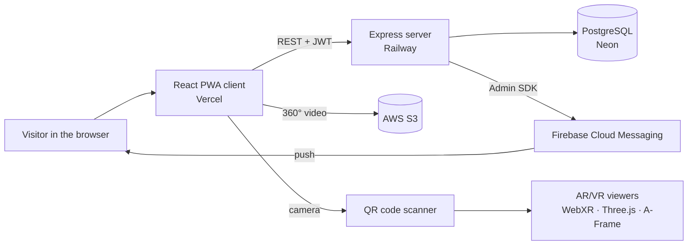
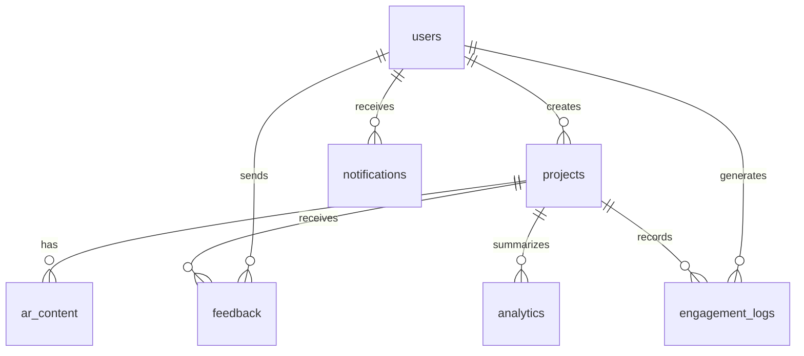

# Architecture

VARHub is a single-page app (SPA/PWA) that talks to a REST API. Two external services complete the picture: **Neon** (PostgreSQL) and **Firebase** (push).



## Client (`varhub-client`)

```text
src/
  App.jsx                 routes: /, /login, /projects (private), /scan
  context/AuthContext.jsx login, sign-up and session (token in localStorage)
  utils/api.js            Axios with the JWT on every request
  pages/                  Home, Login, Projects, QRScanner
  components/             NavBar, Footer, PrivateRoute, QRScanner, ARViewer, FeedbackForm
  firebase.js             Firebase config and notification permission
public/
  firebase-messaging-sw.js  background notification service worker
  webxr-samples-main/       local WebXR samples (MIT)
website/                  this documentation site (Docusaurus)
```

The `/projects` route uses `PrivateRoute`: without a token, the visitor is sent to the login page. The PWA is generated by `vite-plugin-pwa` (Workbox), with cache-first for images and `.glb` models and network-first for PDF and JSON.

## Server (`varhub-server`)

```text
server.js                 Express, allow-list CORS, Helmet, rate limit, /health
db.js                     PostgreSQL pool (SSL with verification)
middleware/auth.js        requireAuth, optionalAuth and signToken (HS256 JWT)
controllers/ + routes/    auth, projects, feedback, analytics, notifications
firebaseAdmin.js          Firebase Admin (environment variable or local file)
db/schema.sql             table schema
scripts/check-*.js        utilities that check/create tables
```

## Data model



Column details are in `db/schema.sql`. The `engagement_logs` table accepts a null `user_id` for anonymous visitors.

## Deployment

The client is published on Vercel (the `VITE_API_URL` variable points to the server) and the server on Railway, which sits behind a proxy (`trust proxy` is on). The client origin must be listed in `ALLOWED_ORIGINS` for CORS.
