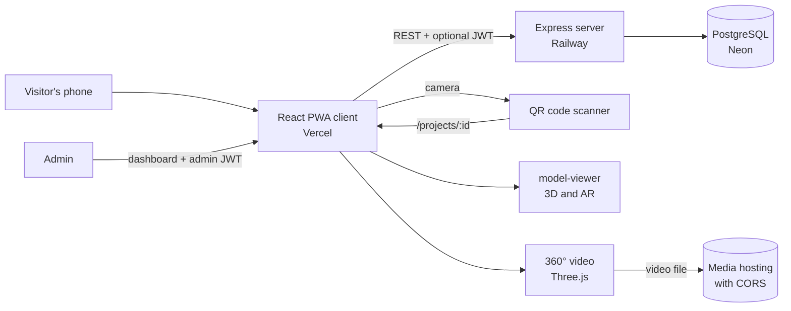
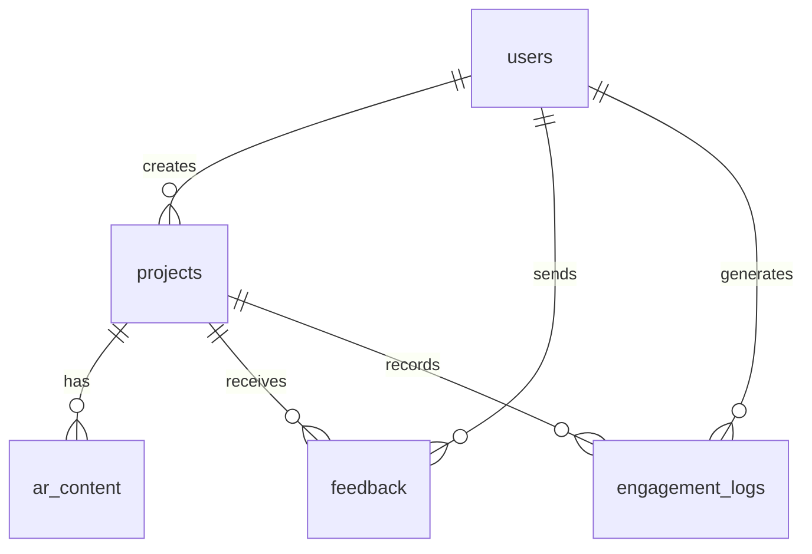

# Architecture

VARHub is a single-page app (SPA/PWA) that talks to a REST API and PostgreSQL.



## Client (`varhub-client`)

```text
src/
  App.jsx                 routes, with pages loaded on demand
  context/AuthContext.jsx session: token in localStorage, validated via /api/auth/me
  brand.js                name, organization, tagline and source link (via .env)
  utils/api.js            Axios, error messages and track() for events
  utils/qr.js             decides what a QR code means (tested)
  pages/                  Home, Projects, Project, Scan, Login, Admin
  components/             NavBar, ModelViewer, Video360, QRScanner, FeedbackForm, ProjectCard...
vite.config.js            /api proxy, optional HTTPS (dev:phone), PWA and caching
website/                  this documentation site (Docusaurus)
```

Decisions that matter:

- **Light first screen.** Initial JavaScript is about 300 KB; the 3D viewer, 360° video and dashboard load only on the pages that use them.
- **No login for visitors.** Gallery, project and feedback are public; an account is optional.
- **Same origin in development.** Vite forwards `/api` to the server, avoiding CORS and mixed content on a phone.
- **Works offline.** The project list uses *stale-while-revalidate*; images and models use cache-first.

## Server (`varhub-server`)

```text
app.js / server.js        Express (testable) and startup
db.js                     PostgreSQL pool (TLS verified outside localhost)
middleware/auth.js        requireAuth, optionalAuth, requireAdmin, signToken (HS256 JWT)
middleware/limits.js      rate limits
controllers/ + routes/    auth, projects, feedback, analytics, notifications
db/migrations/*.sql       versioned schema; db/seed.sql with demo data
scripts/                  migrate.js and make-admin.js
test/api.test.js          integration tests
```

## Data model



`users.role` is `visitor` or `admin`. `projects.type` is `model`, `video360`, `webxr` or `link`, and `projects.status` is `draft`, `published` or `archived` (only published ones are public). `feedback.user_id` and `engagement_logs.user_id` are null for anonymous visitors.

## Deployment

The client goes to Vercel with `VITE_API_URL` pointing at the server; the server goes to a Node host with PostgreSQL (Railway and Neon in the original project). The client origin must be listed in `ALLOWED_ORIGINS`.
